  

  
  
  
  

### Hi, I'm Justin 👋

I run **Justin Productions**, a small studio in Târgoviște, Romania. I design and build websites,
shoot and edit video, and help businesses get found on Google. Clients across Romania and abroad,
from local clinics and car dealers to online shops.

- 🌐 **Websites:** fast Next.js sites and WordPress / WooCommerce shops, built to bring enquiries
- 🎬 **Video:** brand films, promo reels and code-animated motion graphics
- 🔎 **SEO:** technical SEO, Google Business Profile and content that answers real questions
- 🤖 **Automation:** site monitoring, Telegram alerts and AI-assisted workflows behind all of it

### Selected work

| | Project | What |
|---|---|---|
| 🛒 | [**RMG Systems**](https://rmg.ro/) | B2B online shop for security and networking equipment |
| ☕ | [**Wayta Coffee**](https://waytacoffee.com/) | Specialty coffee shop with online ordering and payments |
| 🚗 | [**Çağ Otomotiv**](https://cagotomobil.com/) | Website and promo reel for a Škoda dealer |
| 🔧 | [**BizShop**](https://biz-shop.ro/) | WooCommerce shop for premium BMW and Mercedes-Benz parts, filtered by model and generation |
| 🎥 | [**Start Frame AI**](https://www.startframe.ai/) | Website for an AI video production studio in Istanbul |
| 🖼️ | [**Picspresso**](https://picspresso.com/) · [code](https://github.com/justinproductions/picspresso) | Browser-based image converter, open source |

More in the [portfolio](https://justin.productions/ro/portofoliu/).

### Tools I use

  

### Activity

<picture>
  <source media="(prefers-color-scheme: dark)" srcset="https://raw.githubusercontent.com/justinproductions/justinproductions/output/snake-dark.svg">
  
</picture>

Most of my work lives in private client repositories, so the graph shows more than the repo list does.
